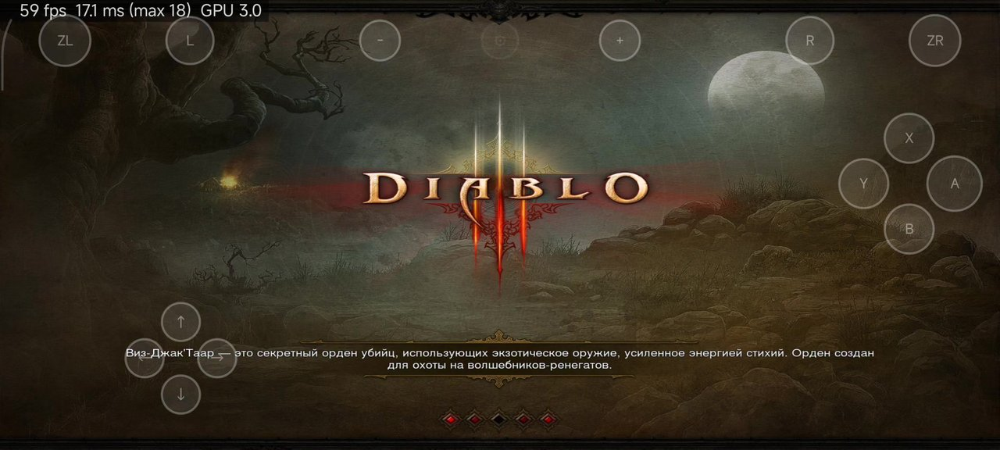
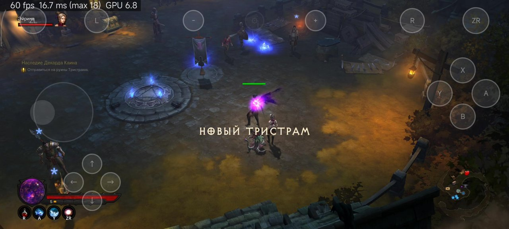
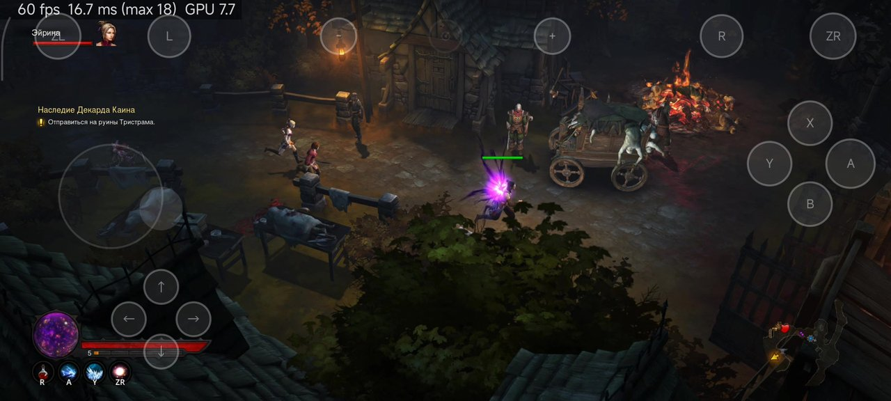
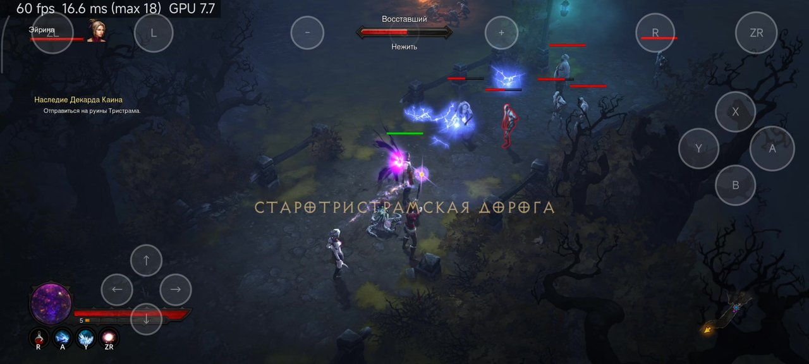
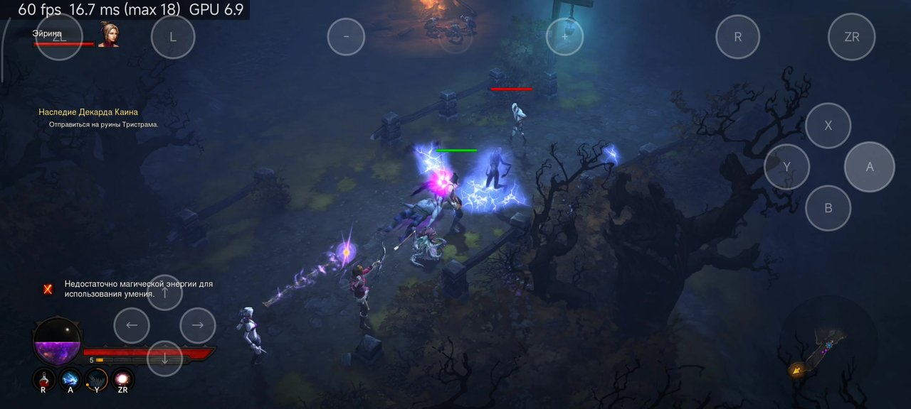
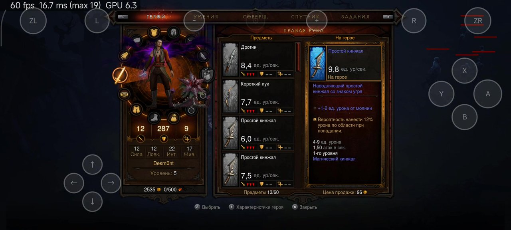
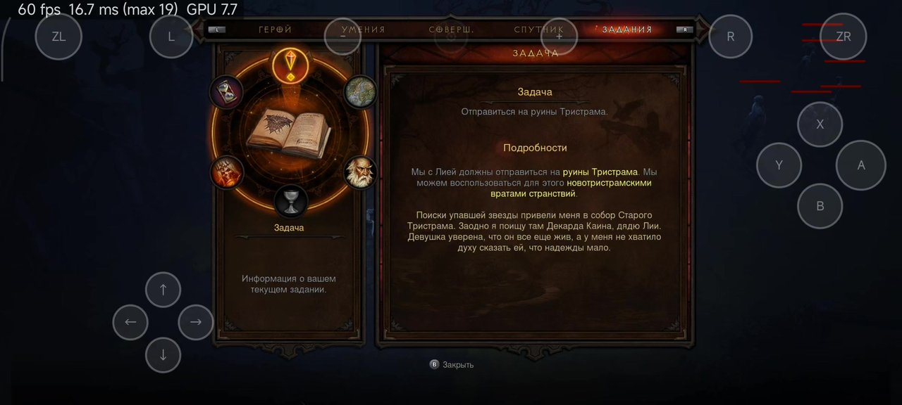
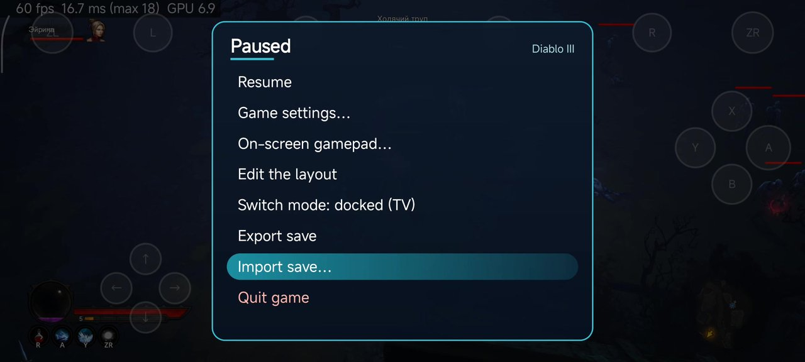
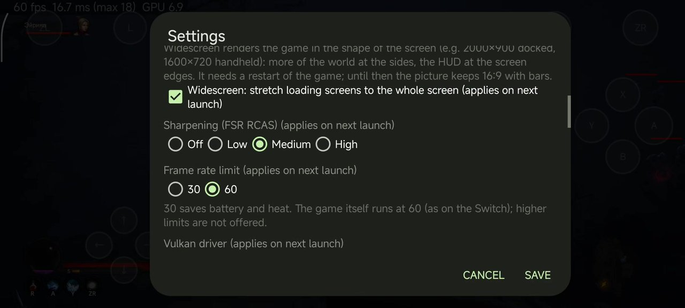

# Diablo III Mobile

**A native Android port of Diablo III: Eternal Collection for Nintendo Switch.** The game's own AArch64 program runs
directly on the phone's CPU; a small host provides the Switch system services (HLE of the `nn::` SDK), and the NVN
graphics API is replayed on Vulkan. You bring the game: this repository contains no game content and no keys.

Русский: [ниже](#по-русски).

**Install:** step-by-step guide for players — [docs/INSTALL.md](docs/INSTALL.md) (English) ·
[docs/INSTALL.ru.md](docs/INSTALL.ru.md) (по-русски). In short: dump your own game + update v1441792 (and, if you want
another language, its language-pack DLC) and `prod.keys`, put them into `put-game-files-here/`, double-click `setup.bat`
(or `bash setup.sh`), copy `work/Diablo3Mobile` to the phone's `Download` folder and install the APK (build it with
`build.bat`, see *Building*).

> **Tested so far on one device: Snapdragon 8 Gen 3 / Adreno 750 (Xiaomi 14 Ultra) with the bundled Mesa Turnip driver.**
> Other GPUs are untested.

## Screenshots

Captured on the phone (Xiaomi 14 Ultra, Adreno 750, Mesa Turnip 27) with the widescreen option on: the game renders
2000×900 at the screen's 20:9 shape (wider view, nothing stretched; loading screens are stretched to fill the screen).
The counter in the top-left corner is the port's own FPS / frame time / GPU time overlay (it can be turned off). Game
text in Russian from the language-pack DLC; on-screen controls in the touch-friendly gamepad layout.

| | |
|---|---|
|  |  |
|  |  |
|  |  |
|  |  |

The gear button opens the pause menu (the game stops, as with the Switch HOME menu); *Game settings…* holds the port's
own options:



## What it is, and what it is not

**It is:**

- The original game code, **executing natively** on the phone — no emulated CPU, no JIT. Switch and Android phones
  share the AArch64 instruction set; an offline rewriter (`dm/tools/patch_nso.py`) changes only the few instructions
  that cannot run unchanged on Linux (x18 use, TLS reads, system calls, counter reads) into calls to the host, and
  `dm/verify/equiv.py` checks every rewritten site against the original instruction before you play.
- An HLE host for the Horizon OS services Diablo III uses (SDK **8.2.0**: threads, memory with the VAMM address space,
  file system, audio renderer, input, account, add-on content…), and an NVN (**API version 53**) → Vulkan recorder and
  engine tuned for Adreno GPUs. The game's shaders are taken from its CPK archives and translated to SPIR-V offline on
  your PC.
- A phone port: touch controls designed for Diablo (floating move stick, touch-to-walk, skill buttons with the game's
  own skill icons, menu gestures), game controllers, an optional **widescreen (Hor+)** mode, sharpening, a 30 / 60 fps
  limit, rumble, and the game's own languages through its language-pack DLC.

**It is not:**

- An emulator, cloud gaming or streaming.
- **A source of game content.** There is no game program, data, shader, text, art or key in this repository, and the
  APK contains none. You dump the game from a Switch you own and convert it on your PC
  ([docs/d3/GAME_FILES.md](docs/d3/GAME_FILES.md)). What the repository knows about the game (patch addresses, structure
  offsets, format descriptions…) is listed in [docs/d3/DERIVED.md](docs/d3/DERIVED.md).
- Online. Battle.net, local wireless, amiibo and the shop answer like a console without a connection; the game takes its
  offline branch (single player, local saves).
- Affiliated with Blizzard Entertainment or Nintendo.

## Current state

Tested on **Snapdragon 8 Gen 3 / Adreno 750** (Xiaomi 14 Ultra) with Mesa Turnip v27.

- Boot, the AUTOSAVE notice, the title screen, the main menu, hero creation and **Act 1 gameplay run at 60 fps** (the
  game's own cap, as on the Switch); GPU time is about 10–11 ms per frame in Act 1 at the docked resolution.
- Output: the Switch's **docked 1600×900** (or handheld 1280×720) render, shown as 16:9 with bars, stretched, or —
  with the **widescreen** option — rendered in the screen's own shape (e.g. 2000×900 on a 20:9 phone) with a wider view at
  the sides (Hor+), the HUD at the screen edges and the loading screens stretched to fit.
- Input: a touch layout made for Diablo (left stick appears under the thumb, touch-and-hold the world to walk there,
  double-tap to evade, skill buttons A / B / X / Y / R / ZR, L = potion, a MENU mode with swipe / tap gestures for the
  console menus), a Joy-Con-like gamepad layout, Bluetooth / USB controllers, rumble. Positions, size and opacity of the
  on-screen controls can be edited.
- Unified front end (shared with the DOOM Mobile port): a pause menu that really holds the game, gamepad skins
  (nx2android's theme packs) and a layout editor, save export / import, live docked / handheld switching.
- Port settings (gear button): menu and game language, game resolution (docked / handheld), picture shape (bars /
  stretched / widescreen), stretched loading screens, FSR RCAS sharpening, frame rate limit (30 / 60), Vulkan driver,
  vibration, FPS counter, stick dead-zone compensation, control layout and editing, skill icons on buttons, the gear
  button's look.
- Languages: English out of the box; other languages (e.g. Russian, index 10) need the game's language-pack DLC, which
  setup extracts when you put it next to the game files.

### Known issues

- Only update **v1441792** (game patch 2.7.7) is supported; the patches and addresses are tied to its build id
  (`main` 2607a74f…, `sdk` 3ae34e68…).
- Only one device has been tested; other Snapdragon devices may work, other GPUs (Mali, PowerVR, Xclipse) are untested.
- The offline game cannot use online features (seasons, clans, Battle.net co-op).
- Long sessions (heat, memory) and the later acts have seen less testing than Act 1. Reports are welcome.
- Many renderer and host fixes are still behind switches for A/B testing (`Download/Diablo3Mobile/dm/env`); see
  [docs/d3/](docs/d3/).

## Building

Requirements: Android SDK with NDK r29 (29.0.14206865), CMake ≥ 3.22 and Ninja, JDK 17+ and Gradle, Python 3. Clone
with submodules:

```sh
git clone --recursive <this repository>
# or, in an existing clone:
git submodule update --init --recursive
```

Configure the native host for Diablo III (`DM_GAME=d3`; the default `d2r` builds the original D2R host):

```sh
cmake -S dm/android -B work/build-android -G Ninja \
  -DCMAKE_TOOLCHAIN_FILE=$ANDROID_NDK_HOME/build/cmake/android.toolchain.cmake \
  -DANDROID_ABI=arm64-v8a -DANDROID_PLATFORM=android-31 -DCMAKE_BUILD_TYPE=Release -DDM_GAME=d3
```

Then build, sign and (optionally) install the APK — `build.bat` on Windows (wraps the PowerShell script), `pwsh`
elsewhere:

```sh
build.bat [-Install <adb serial>]                 # Windows
pwsh tools/build_apk.ps1 [-Install <adb serial>]  # Linux / macOS with PowerShell
```

The script reads every tool path from the environment (`ANDROID_HOME`, `JAVA_HOME`, `GRADLE`, `PYTHON`) and signs with
`DM_KEYSTORE` (default: the Android debug keystore in `~/.android`). Output: `work/D3-port-debug.apk`, app id
`org.diablo3.port` ("Diablo III Mobile"). It downloads the default Turnip driver with a pinned SHA-256
(`tools/fetch_turnip.py`) the first time. `work/` is git-ignored and holds every build output and every game-derived file.

## Installing

Full guide: **[docs/INSTALL.md](docs/INSTALL.md)** (English) / **[docs/INSTALL.ru.md](docs/INSTALL.ru.md)** (Russian).

1. Dump your own copy (base game `01001B300B9BE000` + update `01001B300B9BE800` **v1441792**, as NSP / NSZ / XCI / XCZ;
   optional language packs, e.g. Russian `01001B300B9BF00A`) and your console's `prod.keys` — e.g. with nxdumptool and
   Lockpick_RCM on your Switch.
2. Put the files into `put-game-files-here/` (any names) and double-click `setup.bat`, or run `bash setup.sh` on
   Linux / macOS (explicit files in any order work too; `setup check` reports what is missing and changes nothing).
   Setup provides Python, its packages and the .NET 10 SDK in `tools/.runtime` when they are missing (it asks first),
   checks the inputs and the free space (~20 GB while preparing, more with NSZ / XCZ or language packs), then extracts the
   program, patches it, checks the patch, extracts the data, translates the shaders and extracts the language packs into
   `work/Diablo3Mobile` (~16 GB, +5–6 GB per language pack). Technical details: [docs/d3/GAME_FILES.md](docs/d3/GAME_FILES.md).
3. Copy `work/Diablo3Mobile` to the phone's `Download` folder (USB cable, *File transfer* mode, or `setup push` /
   the adb commands setup prints) and install the APK.
4. Start *Diablo III Mobile* and allow *All files access* when asked.

## Vulkan drivers

The APK bundles **Mesa Turnip v27** (an adrenotools build of Mesa main for Adreno 6xx/7xx) and uses it by default; it
falls back to the phone's own driver when Turnip does not load or finds no supported GPU. Your own adrenotools driver
package can be copied into `Download/Diablo3Mobile/drivers/` and chosen in the gear dialog. Details and known packages:
[drivers/README.md](drivers/README.md).

## Repository layout

| Path | What |
|---|---|
| `dm/` | The host (from d2r-mobile, via DOOM Mobile): loader, HLE (`dm/host`, Diablo III code in `hle_d3.c` / `hle_d3_ui.c` and behind `DM_GAME_D3`), NVN recorder and Vulkan engine (`dm/gfx`), Android app (`dm/android`), offline rewriter (`dm/tools/patch_nso.py`) and its verifiers (`dm/verify`). The tree also carries the DOOM, DOOM Eternal and Xenoblade 2 code paths of the same host family (`DM_GAME=doom / eternal / xc2`); Diablo III builds on the lean DOOM core and reuses the XC2 shader translator. |
| `setup.sh`, `setup.bat`, `build.bat` | Game file preparation (`tools/setup_d3.py`) and APK build entry points |
| `tools/` | Diablo III tooling: package / RomFS / ExeFS readers, CPK archive reader, shader jobs and translation, DLC extraction, APK build, device test and analysis scripts |
| `third_party/libadrenotools` | git submodule (BSD-2-Clause) |
| `drivers/` | Notes on the bundled and optional Vulkan driver packages (no binaries) |
| `docs/d3/` | Port documentation: journal, CPK format, shaders, build gates, widescreen, touch design, performance notes, game files, derived information |
| `docs/THIRD_PARTY.md`, `docs/DEPENDENCIES.md`, `docs/DERIVED.md`, `docs/upstream/` | Attribution: code ported from other projects, the third-party code and D2R-derived records inherited from d2r-mobile, and d2r-mobile's acknowledgements |

## Credits

Diablo III Mobile stands on the work of others — thank you:

- **[d2r-mobile](https://github.com/jhaizhou-ops/d2r-mobile)** by jhaizhou (MIT) — the base of this port: native
  NSO loader and rewriter, HLE host, NVN → Vulkan engine, shader translation chain and Android app (Java package
  `com.xiaoboluo.d2r`). Its Android app and Vulkan engine came from community contributors; see its
  [acknowledgements](docs/upstream/README-d2r-mobile.md).
- **[nxnative](https://github.com/seedds/nxnative)** by seedds (MIT) — threads and SVCs, SDK services (including the
  amiibo / local-wireless stubs and the SDK 8.2 reference profile), audio renderer, NVN entry points, the shader program
  key, patcher and translator pieces.
- **[nx2android](https://github.com/shirai91/nx2android)** (MIT, seedds) — window acquire-sync fix, Android haptics,
  ADPF, gamepad code, the on-screen gamepad theme packs and layout, the save-transfer and pause-hold designs.
- **[BOTWRecompAndroid](https://github.com/mamcjr/BOTWRecompAndroid)** (MIT, Peiikai / mamcjr) — the Turnip / adrenotools
  driver loading approach, the sync-lag idea and NVN 55 object sizes (ideas, re-implemented).
- **[D3CPKUnpack](https://github.com/RedMadKnight/D3CPKUnpack)** by Krzysztof Janiszewski (RedMadKnight, MIT) — the
  Diablo III console CPK archive library, vendored as `tools/d3cpklib.py`.
- **[libadrenotools](https://github.com/bylaws/libadrenotools)** by Billy Laws (BSD-2-Clause).
- **Ryujinx** shader translator (Ryujinx Team and Contributors, MIT), vendored by d2r-mobile in `dm/third_party/ryujinx`.
- **[AMD FidelityFX FSR 1](https://github.com/GPUOpen-Effects/FidelityFX-FSR)** RCAS (MIT).
- **[Mesa](https://mesa3d.org) Turnip** (MIT) — the default Vulkan driver, bundled in the APK as the adrenotools build
  by **[The412Banner](https://github.com/The412Banner/Banners-Turnip)** (Mesa main). Not stored in this repository:
  `tools/fetch_turnip.py` downloads it at build time with a pinned SHA-256.
- Khronos **Vulkan validation layers** (Apache-2.0) — used for debugging, not redistributed.

Details per file: [docs/THIRD_PARTY.md](docs/THIRD_PARTY.md).

Diablo, Diablo III and Blizzard Entertainment are trademarks or registered trademarks of Blizzard Entertainment, Inc.
Nintendo Switch and NVN are trademarks of Nintendo. This is an unofficial, non-commercial fan project with no affiliation
to either of them. **You must own the game and dump it yourself**: no game files, no keys and no game-derived output are
included or distributed here; play it with a copy you own.

## License

MIT — see [LICENSE](LICENSE). The d2r-mobile copyright notice is kept; third-party components keep their own licenses.

---

## По-русски

**Diablo III Mobile** — нативный порт Diablo III: Eternal Collection для Nintendo Switch на Android. Оригинальный
AArch64-код игры исполняется прямо на процессоре телефона (без эмулятора и JIT); небольшой хост подменяет системные
сервисы Switch (HLE `nn::`, SDK 8.2), а графический API NVN (API 53) воспроизводится через Vulkan. Основа — проект
[d2r-mobile](https://github.com/jhaizhou-ops/d2r-mobile) (MIT) через порт DOOM Mobile.

- **Игры в репозитории нет.** Нужна своя копия Diablo III для Switch (база + обновление v1441792, по желанию — языковой
  пакет DLC, например русский `01001B300B9BF00A`) и свои ключи консоли. **Установка по шагам:
  [docs/INSTALL.ru.md](docs/INSTALL.ru.md).** Технические подробности подготовки файлов —
  [docs/d3/GAME_FILES.md](docs/d3/GAME_FILES.md) (англ.), журнал порта — [docs/d3/D3_PORT.md](docs/d3/D3_PORT.md).
- Проверено на одном устройстве: Snapdragon 8 Gen 3 / Adreno 750 (Xiaomi 14 Ultra) с драйвером Turnip из APK: меню и
  геймплей Акта 1 — **60 fps**. Другие GPU не проверялись.
- Широкий экран (Hor+, по форме экрана телефона), сенсорная раскладка под Diablo (плавающий стик, ходьба по касанию,
  кнопки навыков с иконками из HUD игры, жесты для меню), геймпады, вибрация, резкость RCAS, лимит 30 / 60 fps,
  единое меню паузы, скины геймпада, перенос сохранений.
- Подготовка файлов: положите базу, обновление, `prod.keys` (и языковой пакет) в `put-game-files-here/` и дважды
  щёлкните `setup.bat` (Linux / macOS: `bash setup.sh`); проверка без изменений — `setup check`. Готовую папку
  `work/Diablo3Mobile` скопируйте в `Download` телефона (или `setup push`).
- Сборка: `cmake -S dm/android -B work/build-android … -DDM_GAME=d3`, затем `build.bat` / `tools/build_apk.ps1` (см. «Building»).
